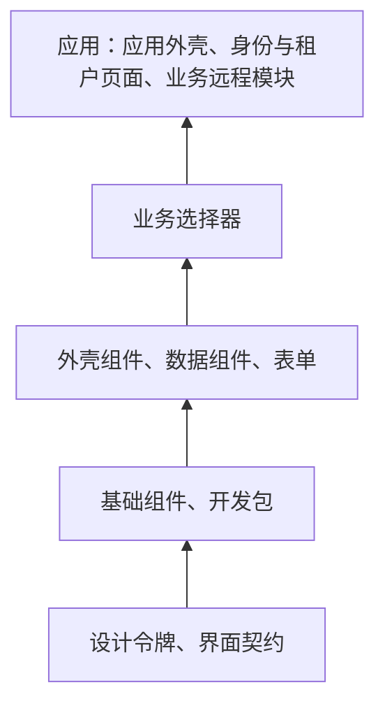

# Qian 框架架构

> 状态：规划稿（2026-11-17）。「已有」指在原仓库 `idadawn/qian` 的前端工作区里已经实现，现在的名字是 yue；包名暂按现状写。

## 1 边界

Qian 负责界面与交互。它不负责：

- 业务数据与权限的判定，那在 Kun。界面里看不到的能力，后端同样拒绝，前端的隐藏只是体验，不是安全措施。
- 智能体的推理，那在 SanYuanAgent。Qian 展示它的过程与结果。

Qian 只经公开的接口与契约访问后端。

## 2 分层与依赖方向

- 箭头表示「被上面依赖」。下层不得引用上层；同一层的包互不依赖，例外要写进决策记录。
- 设计令牌和界面契约在最底层，不依赖任何别的包。
- 允许的依赖写在一张矩阵里，是唯一的依据。新建一个包，先在矩阵里登记；没登记的包什么都不许引用。
- TypeScript 运行时与前端插件开发包在组件库之上：组件库不得反过来引用它们。
- 图表、代码编辑器、控件、移动端、面向智能体的界面等包已经在矩阵里留了位置，还没有实现。

## 3 应用外壳

应用外壳是整个产品的宿主页面。

- **运行时配置。** 外壳启动时从同源地址读配置，同一份构建产物可以部署到不同环境。
- **会话。** 浏览器里不放令牌。登录之后会话由网关持有，前端只带会话 Cookie；会话过期有统一的处理。
- **启动聚合。** 外壳启动时一次取回当前用户、租户、权限与可用的能力。
- **能力导航。** 菜单由后端的能力与权限生成，映射到路由。
- **租户切换、站内信、偏好设置、兜底页。**

外壳本身是一棵插件树。前端有一个与后端同语义的运行时：服务带范围，注册是可以撤销的副作用，租户范围里的注册遮蔽全局项。

## 4 微前端与界面表面

业务页面不打进外壳，它们是远程模块，由外壳按需加载。

- 一个插件的界面表面是一份界面清单：它暴露哪些页面、控件、设置卡。
- 外壳读清单，把页面挂进路由和菜单，把控件挂进插槽。
- 远程模块经桥接接口调用后端能力，不自己拼请求地址，也不自己处理认证。
- 第三方的界面按信任等级隔离运行。这一条在组件模型的规格里已经规定，随第三方组件开放时落地。

## 5 由 Schema 驱动的界面

表单、列表、控件清单都有 JSON Schema，并由它生成类型。

- 表单由 Schema 渲染：字段、联动、校验、脱敏规则都在 Schema 里。
- 列表同理：列、筛选、排序、操作由 Schema 描述。
- 界面契约是 Qian 与 Kun、SanYuanAgent 共用的数据约定。

这是自然语言构建在界面上的落点。智能体要做一个录入页面，产出的是一份表单 Schema；人预览、批准之后，Qian 把它渲染出来。智能体不生成前端代码，也就不需要为它生成的代码做安全审查。

## 6 面向智能体的界面

规划。

| 界面 | 作用 |
|---|---|
| 意图输入 | 人用自然语言提出要做的事 |
| 过程展示 | 把智能体运行的事件流展示出来：步骤、工具调用、产物、最终回答 |
| 预览与批准 | 智能体生成的界面与变更，先预览，人批准后发布 |
| 审核收件箱 | 发给我的 Agent 的协同消息，在这里批准、修改、驳回或转交 |
| 我的 Agent | 查看和管理自己名下的 Agent 及其授权范围 |
| 线程视图 | 一件协同事务里人与 Agent 的全部往来 |

见平台总览的 [Agent 协同](https://github.com/CavaiLAB/jiangxin/blob/main/docs/04-agent-collaboration.md)。

## 7 质量门禁与预算

八项门禁，每一项在 PR 上各显示为一个检查：

| 门禁 | 查什么 |
|---|---|
| 代码规则 | 代码规范，含分层边界 |
| 类型检查 | 各包与应用 |
| 单元测试 | 包括真实浏览器里的键盘操作与可访问性用例 |
| 可访问性 | 组件打开状态下严重问题为零 |
| 首屏性能 | 首屏脚本压缩后不超过 250 KB |
| 分层边界 | 依赖方向 |
| 发布形状 | 包的导出、类型、文件清单 |
| 循环依赖 | 循环依赖与解析不了的引用 |

另有视觉回归和文档站检查。

## 8 版本与发布

- 全部包固定同一个版本号。
- 1.0 之前每个次版本都可能有破坏性变更；1.0 之后只在主版本破坏，废弃的接口至少保留一个次版本并给出迁移说明。
- 改了包的公开行为，在 PR 里登记变更级别，合并后由发布流程统一出版本。

## 9 待定

| 事项 | 说明 |
|---|---|
| 包名前缀与发布位置 | 现在的包发在 GitHub Packages，包名带原所有者的前缀。所有者换成 CavaiLAB 之后，前缀与发布位置要重定 |
| 命令行放在哪个仓库 | 命令行属于 Kun，但它是 TypeScript 写的，现在和前端在同一个工作区。放在 `kun` 还是本仓库，待定 |
| 面向智能体的界面放在哪个包 | 提议单独一个包，只依赖基础组件与开发包 |
