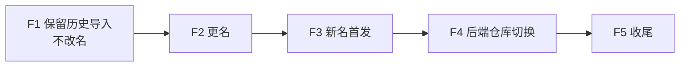

# 迁移与更名

> 状态：执行计划（2026-11-17）。标「已定」的出自产品负责人的裁定；标「提议」的是本计划的安排，执行中发现不对就改；标「待定」的要产品负责人定。数字取自原仓库 `idadawn/qian` 主干的提交 `aafa0cc5ab`。

## 1 裁定

| 事项 | 裁定 | 出处 |
|---|---|---|
| 时点 | 前端现在开始迁移，迁移过程中改名 | 产品负责人 2026-11-17：「前端开始进行迁移，迁移过程中进行改名」 |
| 去处 | 迁入本仓库 `CavaiLAB/qian` | 同上 |
| 范围 | 只迁框架库，见第 2 节 | 产品负责人 2026-11-17 在三个方案里选定 |
| 更名 | 前端框架由 yue 更名为 qian；8 个包名字里的 `yue-` 换成 `qian-`，不换词 | 合并蓝图 ADR-023 D23.17、D23.18（原仓库 `docs/adr/ADR-023-kun-qian-merge-blueprint.md`） |
| 清单里的版本键 | 声明前端版本要求的键用 `qian`；平台运行时的版本并入 `kun` | D23.18 |
| 历史与兼容 | 带旧名字的任务编号与历史日志不改；浏览器本地存储的键换名，不做迁移 | D23.18 |
| 不改的 | `qian` 命令行与 `@qian/*` 的导入名 | D23.18 |
| 许可 | MIT | D23.19 |

时点一条改了合并蓝图原来的安排。蓝图写的是更名与后端 `Qian.*` 改名 `Kun.*` 放在同一个冻结窗口里、排在后端按域归并的最后一批；现在前端先走。带来的一个后果要知道：后端包名改完之前，前端的 qian 会和后端的 `Qian.*` 同时存在，读文档与代码时按包的作用域区分。蓝图上的修订标注在原仓库登记，由后端迁移一侧做。

## 2 范围

### 2.1 迁入本仓库

| 原位置 | 内容 | 改名后的位置（提议） |
|---|---|---|
| `packages/yue/*` | 8 个包：设计令牌、界面契约、基础组件、开发包、外壳组件、数据组件、表单、业务选择器 | `packages/qian/*` |
| `apps/yue-playground` | 组件演练场，也是可访问性、首屏性能与视觉回归的靶场 | `apps/qian-playground` |
| `packages/qian-plugin-sdk` | 前端插件开发包 | 不变 |
| `packages/qian-runtime` | TypeScript 运行时 | 不变 |
| `tests/gates/yue` | 分层边界、循环依赖、包形状等门禁的自测 | `tests/gates/qian` |
| `scripts/yue-visual.mjs` | 视觉回归的入口 | `scripts/qian-visual.mjs` |
| `.changeset/` | 变更级别登记与版本编排 | 不变 |
| `tools/openapi-codegen` | 接口类型生成工具：业务选择器与数据组件包的 `contracts:generate` / `contracts:check` 经根脚本 `openapi:generate` 调它。两边各留一份，后端那份给留在后端的界面包用 | 不变 |
| 根目录的前端工程配置 | 工作区与版本目录、构建编排、代码规则、分层矩阵、循环依赖检查、测试配置 | 裁剪成只含本仓库的包 |
| 八项门禁、运行时、发布的工作流 | 4 个工作流 | 门禁与运行时的两个改写后放在本仓库；两个发布工作流发的是旧名字，F1 删掉，F2 按新名字重写 |

### 2.2 留在后端仓库

这些是平台自己的界面应用，不是框架库。它们的构建产物打进后端的网关镜像与平台镜像交付，端到端测试都要起真实的后端，所以跟后端走；后端仓库保留一套 pnpm 工作区，按钉住的版本消费本仓库发布的包。

| 路径 | 内容 |
|---|---|
| `apps/qian-shell`、`packages/qian-shell-kit` | 应用外壳与它对接平台的专有接线 |
| `packages/qian-identity-ui`、`packages/qian-tenancy-ui`、`packages/qian-tenancy-signup-ui` | 身份、租户运营、租户开通三个组件自带的界面 |
| `samples/qian-sample-crm-ui` | 参考应用的远程模块 |
| `website/` | 文档站。组件页的来源在本仓库的包里，拆开之后怎么取见第 4 节 |
| `packages/qian-cli`、`packages/qian-surfaces` | 命令行、声明式表面的校验库 |
| `tools/openapi-codegen` | 接口类型生成工具。后端也留一份，给留在后端的界面包用；本仓库那份见 2.1 |
| 起真实后端的端到端测试 | 外壳的联邦与认证、租户运营页、真实目录 |

后端仓库现在是 `idadawn/qian`；后端迁往 `CavaiLAB/kun` 之后指那边。下文说「后端仓库」都按这个意思。

### 2.3 留在后端、本仓库取副本的

框架库在构建与测试时读后端的几份冻结契约。它们的唯一来源在后端仓库，本仓库只放副本。

| 来源路径 | 谁在用 | 用途 |
|---|---|---|
| `contracts/v0/error-detail.schema.json` | 界面契约包、TypeScript 运行时 | 结构化错误的 Schema |
| `contracts/v0/error-codes.json` | TypeScript 运行时、前端插件开发包 | 内置错误码目录 |
| `contracts/v0/fixtures/capability-entry.valid.json` | 前端插件开发包 | 能力条目的测试夹具 |
| `schemas/v2/ui.schema.json` | 前端插件开发包 | 界面清单的 Schema，生成类型与校验器 |
| `tck/surfaces/cases.json` | 前端插件开发包 | 界面清单的一致性用例 |
| `tck/runtime`、`tck/profiles/base`，以及命令行的 profile 解析 | TypeScript 运行时 | 与 .NET 运行时共用的一致性用例 |

前 5 行的副本在本仓库的 `backend-copy/`，按来源路径存放，来源清单与检查脚本的用法见那里的 README。最后一行不复制：它要的是命令行构建出来的装配器与成套的场景，CI 按同一个来源提交检出后端来跑，见第 4 节。

## 3 阶段



| 阶段 | 在哪个仓库 | 做什么 | 退出标准 | 任务 |
|---|---|---|---|---|
| F1 保留历史导入 | 本仓库 | 把 2.1 的路径连同提交历史导入，名字一个不改；裁剪工程配置；建立 2.3 的契约副本与漂移检查；门禁工作流跑在本仓库 | 导入的文件与源提交逐个一致；八项门禁与视觉回归在 PR 上全部通过；导入脚本可重跑 | S1-YUE-023 |
| F2 更名 | 本仓库 | 按第 5 节改名；许可改 MIT；发布工作流改写 | 门禁全部通过；页头带旧名字的视觉基线已重拍；打包结果的名字、文件清单与许可正确，不实际发布 | S1-YUE-022 |
| F3 新名首发 | 本仓库 | 10 个包用新名字首次发布；用空目录里的新项目从包源安装并构建，证明装得上、用得了 | 包在包源上可见；干净消费者验证通过 | S1-YUE-024 |
| F4 后端仓库切换 | 后端仓库 | 删除迁出的目录；留下的应用、界面包、文档站、命令行测试改为消费已发布的包，名字与前缀一并换；界面清单的版本键连同 Schema、一致性用例一起换；部署环境的外壳重建 | 后端仓库的门禁与端到端测试全部通过；部署环境的外壳可用 | S1-YUE-025 |
| F5 收尾 | 两边 | 删除旧名字的 3 个私有包，旧名字的运行时与插件开发包标弃用；文档站组件页的来源定稿；本仓库设保护规则 | 包源上不再有旧名字的可安装版本；文档站组件页与发布的版本一致 | S1-YUE-026 |

阶段一个接一个做，前一个的 PR 合入后才开始下一个。发布（F3）、删除旧包（F5）、部署环境重建（F4）这三步做之前要产品负责人点头。

F1 与 F2 分成两个 PR 的理由：F1 的 PR 只证明「搬过来的东西和原来一样」，F2 的 PR 只有改名，两件事各自好核对。旧名字的包不从本仓库发布，本仓库发出去的第一个版本就是新名字。

**导入的 PR 只能用合并提交合入，不能压缩合并，也不能变基合并**，否则导入的历史就没了。

## 4 两个仓库之间的接口

拆开之后两边只通过下面几样东西往来，都按版本或提交钉住。

| 方向 | 接口 | 做法（提议） |
|---|---|---|
| 后端 → 本仓库 | 2.3 的契约副本 | 副本放在一个明确标成「副本」的目录里，附一份清单：来源仓库、来源提交、每个文件的摘要。本机检查只核对摘要；CI 另有一项按清单里的提交检出后端仓库，逐个文件比对。后端改了契约，升清单里的提交并更新副本 |
| 后端 → 本仓库 | 运行时的一致性用例 | TypeScript 一侧的一致性用例留在后端仓库，对已发布的运行时包跑。本仓库另设一项检查：按钉住的提交检出后端仓库，用工作区里的运行时跑同一套用例，发布前先过一遍 |
| 本仓库 → 后端 | 10 个 npm 包 | 后端仓库写精确版本，不写范围；升级走 PR |
| 本仓库 → 后端 | 文档站要的组件文档源、示例与目录 | 文档站按发布版本对应的标签检出本仓库，和它现在按钉住的版本取 Kun 文档是同一个办法。要不要改成由平台总览的文档站直接出组件页，待定 |
| 本仓库 → 后端 | 后端测试读的两份文件：业务选择器的接口契约、基础组件包的版本号 | 随包发布，后端从安装目录里读 |

前两行在 F1 落地：契约副本的摘要核对在门禁 unit 一项里，逐个文件比对是 `backend-copy` 工作流；运行时的一致性用例是 `runtime-ts` 工作流里的「运行时一致性用例」一项，在后端检出里只装命令行及其依赖、构建命令行，再用本仓库的运行时跑。两者用 `backend-copy/manifest.json` 记的同一个来源仓库、路径前缀与提交。

本仓库不需要后端的镜像，也不需要 .NET 工具链。

## 5 更名规则（F2）

| 项 | 旧 | 新 |
|---|---|---|
| 8 个包 | `@idadawn/yue-<名>` | `@cavailab/qian-<名>`：biz、contracts、core、data、form、sdk、shell、tokens |
| 运行时与插件开发包 | `@idadawn/qian-runtime`、`@idadawn/qian-plugin-sdk` | `@cavailab/qian-runtime`、`@cavailab/qian-plugin-sdk` |
| 目录 | `packages/yue/`、`apps/yue-playground`、`tests/gates/yue` | `packages/qian/`、`apps/qian-playground`、`tests/gates/qian` |
| 样式变量 | `--yue-*` | `--qian-*` |
| 测试标识与可寻址属性的默认前缀 | `yue-` | `qian-` |
| 根脚本、工作流名 | `yue:*`、`yue` | `qian:*`、`qian` |
| 包里带旧名字的产物名 | 例如基础组件包导出的清单文件 | 换成新名字 |
| 浏览器本地存储的键 | 带 `yue` 的键 | 换名，不迁移旧值 |
| 界面清单的版本键 | `engines.yue` | `engines.qian` |
| 许可 | Apache-2.0 | MIT，仓库根放许可证文件 |
| 包元数据里的仓库地址 | `idadawn/qian` | `CavaiLAB/qian` |

作用域用 `@cavailab` 的原因：包发在 GitHub Packages 上，它要求包的作用域与仓库所有者同名。蓝图当时写的是 `@idadawn/qian-<名>`，名字的其余部分照蓝图不变。

不改的：`S1-YUE-*` 任务编号与提交历史里的旧名字；`@qian/*` 导入名；`qian` 命令行；组件 id 前缀 `qian.` 等运行期字面。

界面清单的版本键有先后问题。Schema 的唯一来源在后端仓库，而后端要等新包发布之后才切换（F4）。做法：F2 里本仓库的副本先改成新键，在清单里记为「领先于来源」；F4 的 PR 在后端仓库把 Schema、一致性用例与各界面清单一起换掉，合入后把清单里的来源提交推进到它，「领先」的标记去掉。

改名会影响使用方：样式变量、测试标识的前缀变了，使用方自己的样式覆盖与测试选择器要跟着改。F2 的 PR 要带一份迁移说明。

## 6 冻结与在途工作

- 从提交 `aafa0cc5ab` 起，2.1 的路径在原仓库冻结，不再合入改动。F2 合入之前确有改动要进，就在原仓库合入后重跑导入脚本补齐；F2 合入之后一律在本仓库改。
- 冻结只针对 2.1 的路径。2.2 的路径照常开发。
- 原仓库里还没做完、又要动框架库的任务（例如认证页其余视图的样式调整），等 F2 合入后在本仓库做，再由后端仓库升版本。
- 导入开始时原仓库没有开着的前端 PR。

## 7 风险与对策

| 风险 | 对策 |
|---|---|
| 导入的 PR 被压缩合并，历史丢失 | PR 描述里写明；合入前把仓库设成只允许合并提交 |
| 裁剪工程配置时依赖版本漂了 | 版本目录原样带过来；重新生成锁文件后与原锁文件比对留下的依赖，版本要逐个一致 |
| 契约副本与后端不一致而没人发现 | 第 4 节的摘要核对加 CI 比对 |
| 运行时改坏了一致性，发布后才在后端发现 | 第 4 节的发布前检查 |
| 新旧名字的包并存期间装错 | 旧名字的包不再发布新版本；F4 一次换完，F5 删除旧包 |
| 后端仓库装不上新包 | GitHub Packages 上的 npm 包即使公开也要带令牌才能装。F3 定包的可见性，F4 在后端仓库的 CI 与本机说明里配好读取 |
| 后端迁往新仓库与 F4 撞在一起 | F4 开工前与后端迁移一侧对一次：当时的主干在哪个仓库，同一批文件只有一边写 |

## 8 待定

| 事项 | 提议 | 什么时候要定 |
|---|---|---|
| 首发的版本号 | 10 个包统一从 0.2.0 起 | F3 之前 |
| 包的可见性 | 公开。仓库已经公开，许可是 MIT | F3 之前 |
| 发布位置 | 先沿用 GitHub Packages。要让外部开发者不带令牌就能装，得发到公共的 npm 包源，那需要先有组织账号与发布令牌 | 可以晚于 F3 |
| 文档站的组件页由谁出 | 先由原文档站按标签检出本仓库来出 | F4 之前 |
| 任务放在哪里 | 迁移期间仍登记在原仓库的 `pm/`；本仓库要不要自己的任务目录，等后端迁移一侧把看板的去向定了再说 | F5 |

## 9 导入记录

F1（S1-YUE-023）的导入，2026-11-17。脚本与做法见 [导入脚本](../scripts/import/README.md)。

| 项 | 结果 |
|---|---|
| 源 | `idadawn/qian` 主干的提交 `aafa0cc5ab48637a1c634867d6cddb2935837814`。导入时主干已前进 15 个提交，都没有碰导入路径 |
| 导入的路径 | `scripts/import/paths.txt` 的 22 条：2.1 的全部路径（含 `tools/openapi-codegen/`），加上清单之外确实需要的根目录 `.gitignore` |
| 过滤结果 | 154 个提交，末端 `c7d945775c244da51a5fb351e29b3ad10c04a9b6`，580 个文件。用的是 `git-filter-repo` 2.47.0；脚本从 GitHub 新克隆、与指向本机克隆各跑一遍，末端相同 |
| 提交说明 | 50 处指向源仓库 PR 的 `#N` 改写成 `idadawn/qian#N`（另有 1 处原本就这样写）；1 处指向保留下来的提交的哈希换成新哈希。逐个对回源提交比较，没有其它改动；任务号不变 |
| 合并提交 | `df9d7a1deb5b5b416e894c8f9e540d840ee0e7e0`，第二个父提交是上面的末端 |
| 一致性证明 | 在合并提交上（裁剪之前）跑 `scripts/import/verify.sh`：源提交的文件 580 个，一致 580，不一致 0，缺少 0，多出 0；导入的提交 154 个。另按目录树与文件的对象哈希核对 22 条路径，全部相同 |
| 改名排查 | 全历史按 50% 与 30% 两档相似度找改名，合并提交也算：没有从清单之外改名进入导入路径的文件，不需要补旧路径。反方向有 3 个文件从 `packages/yue/shell/src` 改名迁进留在后端的 `packages/qian-shell-kit`（S1-YUE-012），在导入的历史里表现为删除 |
| 锁文件 | 裁剪之后重新生成，与原锁文件逐项比对：留下的 13 个工作区项目、200 个直接依赖、828 个包、832 个快照完全相同，没有出现新版本；去掉的是 9 个没迁来的工作区项目与只被它们用到的 258 个包。版本目录原样保留 |

导入用的命令：

```bash
scripts/import/import.sh --commit aafa0cc5ab48637a1c634867d6cddb2935837814 --out <空目录>
git fetch <空目录> import
git merge --allow-unrelated-histories --no-ff FETCH_HEAD
scripts/import/verify.sh --commit aafa0cc5ab48637a1c634867d6cddb2935837814 --target <合并提交>
```

合并之后的改动都是单独的提交，名字一个不改：

- 裁剪工程配置：工作区、根脚本、eslint、分层矩阵、循环依赖检查、vitest 的 projects、变更登记的忽略清单、令牌检查的扫描范围只含迁入的框架库；`turbo.json` 只加了 `"agentGuidance": false`，免得 turbo 往 `AGENTS.md` 写它自己的段落。
- 删掉只服务于留在后端的东西：门禁自测 `shell-dist.test.ts`（测外壳的产物校验脚本）；`boundaries.test.ts` 里外壳、认证页族、参考远程可以引外壳接线的 4 条断言（「应用可以消费开发包」那条改用演练场的路径）；演练场的真实目录端到端测试 `e2e:directory` 及它专用的 Playwright 与 Vite 配置、页面（要靠后端的 `dev-tenant-ops.sh` 起真实后端）；两个发布工作流。
- 契约改读 `backend-copy/` 里的副本（第 2.3 节）；运行时的一致性用例从默认的 `test` 拆出，成为 `test:tck`（第 4 节）。
- 导入的 README 里 19 处指向后端仓库文件的相对链接，改成指向源提交的完整地址。

重跑与增量补齐：F2 合入之前，原仓库里导入路径确有改动要进时，按导入脚本说明里的「增量补齐」做：用新的源提交重跑 `import.sh`，核对上次的末端 `c7d945775c` 是新末端的祖先，再合并，只核对这一段改过的路径，并在这一节补一行。F2 合入之后不再从原仓库导入。
