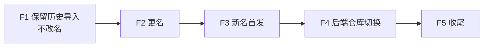

# 迁移与更名

Qian 前端框架已从后端工作区迁入 `CavaiLAB/qian`，原有提交历史随源码保留。升级项目可按包名、样式、存储键和插件清单逐项调整。[使用方迁移说明](migrating-from-yue.md)

## 维护入口

本次前端迁移按 Qian 0.2.1 归档验收。Kun 中的外壳源码继续保留。业务预发运行原版外壳与远程模块，保留现有数据。归档范围与现网处置见[第 13 节](#13-冻结版本的归档验收)。

| 需要做什么 | 去哪里 |
|---|---|
| 查冻结版本的框架和示例 | 核心包标签 `@cavailab/qian-core@0.2.1` 对应的 `packages/qian/`、`packages/qian-runtime/`、`packages/qian-plugin-sdk/` 与 `apps/qian-playground/`。 |
| 查已发布的 npm 包 | 10 个包的 0.2.1 在 CavaiLAB 的 GitHub Packages。八个界面层包属于一个固定版本组，TypeScript 运行时与前端插件开发包各自定版本。 |
| 查组件文档 | 现有组件文档站按核心包发布标签取源码和示例。查阅冻结版本时使用 `@cavailab/qian-core@0.2.1`。 |
| 查迁移任务 | `S1-YUE-*` 的状态、依赖和验收记录随 Kun 任务看板保存，继续按原编号查阅。[Kun 任务目录](https://github.com/CavaiLAB/kun/tree/main/pm/tasks) |

包的版本分组及组件页的取材方式见平台的[发布与组件文档裁定 P34、P35](https://github.com/CavaiLAB/jiangxin/blob/main/docs/decisions/2026-11-20-release.md)。

第 1 至 8 节保留 2026-11-17 制订的迁移方案，盘点基点为 `idadawn/qian@aafa0cc5ab`。第 9 至 12 节记录源码导入、更名、包发布和后端使用方切换的实际结果。

## 1 裁定

| 事项 | 裁定 | 出处 |
|---|---|---|
| 时点 | 前端现在开始迁移，迁移过程中改名 | 产品负责人 2026-11-17：「前端开始进行迁移，迁移过程中进行改名」 |
| 去处 | 迁入本仓库 `CavaiLAB/qian` | 同上 |
| 范围 | 只迁框架库，见第 2 节 | 产品负责人 2026-11-17 在三个方案里选定 |
| 更名 | 前端框架由 yue 更名为 qian；8 个包名字里的 `yue-` 换成 `qian-`，不换词 | 合并蓝图 ADR-023 D23.17、D23.18（原仓库 `docs/adr/ADR-023-kun-qian-merge-blueprint.md`） |
| 清单里的版本键 | 声明前端版本要求的键用 `qian`；平台运行时的版本并入 `kun` | D23.18 |
| 历史与兼容 | 带旧名字的任务编号与历史日志不改；浏览器本地存储的键换名，不做迁移 | D23.18 |
| 不改的 | `qian` 命令行与 `@qian/*` 的导入名 | D23.18 |
| 许可 | MIT | D23.19 |
| 许可证的版权行 | `Copyright (c) 2026 Qian Framework Contributors`，仓库根与运行时包的许可证文件都用这一行 | 产品负责人 2026-11-17 确认 F2 的提议 |
| 规划中的渲染层 | 分层矩阵为运行时层预留的包定名为 renderer（`@cavailab/qian-renderer`），TypeScript 运行时的名字不变 | 产品负责人 2026-11-17，见第 10.1 节 |
| 首发的版本号 | 10 个包统一 0.2.0 | 产品负责人 2026-11-17，照第 8 节原来的提议 |
| 版本分组 | 8 个层包同属一个 Changesets 固定版本组。TypeScript 运行时和前端插件开发包分别定版本 | 产品负责人 2026-11-20 确认 |
| 当前版本 | Qian 冻结在 0.2.1。产品 Web 和桌面端采用 DSH 客户端，后续需要的组件按 DSH 的写法迁入平台自己的界面包。Qian 是否再发新版、产品登录后端如何接入均待定 | [产品裁定 P38](https://github.com/CavaiLAB/jiangxin/blob/9d1c1475acb7d10c85b415ff7b2400ad6fe88ed1/docs/decisions/2026-11-20-product.md) |
| 组件文档 | 组件文档站按本仓库的 `@cavailab/qian-core@<版本>` 标签生成并发布组件页，源码与示例随标签取用 | 产品负责人 2026-11-20 确认 |
| 包的可见性 | 公开 | 产品负责人 2026-11-17，照第 8 节原来的提议。GitHub Packages 上怎样才算公开、要谁动手，见第 11.2 节 |
| 发布位置 | GitHub Packages（`https://npm.pkg.github.com`，作用域 `@cavailab`） | 产品负责人 2026-11-17：知情后说按提议开工。要让外部开发者不带令牌就能装，得另发到公共的 npm 包源，那需要先有组织账号与发布令牌，现在不做 |

时点一条改了合并蓝图原来的安排。蓝图写的是更名与后端 `Qian.*` 改名 `Kun.*` 放在同一个冻结窗口里、排在后端按域归并的最后一批；现在前端先走。带来的一个后果要知道：后端包名改完之前，前端的 qian 会和后端的 `Qian.*` 同时存在，读文档与代码时按包的作用域区分。蓝图上的修订已由后端迁移一侧标注在蓝图开头（原仓库归档之前），蓝图现在随原 Qian 的树在后端仓库里（见 2.2）。

## 2 范围

### 2.1 迁入本仓库

| 原位置 | 内容 | 改名后的位置（F2 已改） |
|---|---|---|
| `packages/yue/*` | 8 个包：设计令牌、界面契约、基础组件、开发包、外壳组件、数据组件、表单、业务选择器 | `packages/qian/*` |
| `apps/yue-playground` | 组件演练场，也是可访问性、首屏性能与视觉回归的靶场 | `apps/qian-playground` |
| `packages/qian-plugin-sdk` | 前端插件开发包 | 不变 |
| `packages/qian-runtime` | TypeScript 运行时 | 不变 |
| `tests/gates/yue` | 分层边界、循环依赖、包形状等门禁的自测 | `tests/gates/qian` |
| `scripts/yue-visual.mjs` | 视觉回归的入口 | `scripts/qian-visual.mjs` |
| `.changeset/` | 变更级别登记与版本编排 | 不变 |
| `tools/openapi-codegen` | 接口类型生成工具：业务选择器与数据组件包的 `contracts:generate` / `contracts:check` 经根脚本 `openapi:generate` 调它。两边各留一份，后端那份给留在后端的界面包用 | 不变 |
| 根目录的前端工程配置 | 工作区与版本目录、构建编排、代码规则、分层矩阵、循环依赖检查、测试配置 | 裁剪成只含本仓库的包 |
| 八项门禁、运行时、发布的工作流 | 4 个工作流 | 门禁与运行时的两个改写后放在本仓库，门禁的那个改名为 `qian`；两个发布工作流发的是旧名字，F1 删掉，F2 新写一个 `release`，10 个包一起发 |

### 2.2 留在后端仓库

这些是平台自己的界面应用，不是框架库。它们的构建产物打进后端的网关镜像与平台镜像交付，端到端测试都要起真实的后端，所以跟后端走；后端仓库保留一套 pnpm 工作区，按钉住的版本消费本仓库发布的包。

| 路径 | 内容 |
|---|---|
| `apps/qian-shell`、`packages/qian-shell-kit` | 应用外壳与它对接平台的专有接线 |
| `packages/qian-identity-ui`、`packages/qian-tenancy-ui`、`packages/qian-tenancy-signup-ui` | 身份、租户运营、租户开通三个组件自带的界面 |
| `samples/qian-sample-crm-ui` | 参考应用的远程模块 |
| `website/` | 文档站。组件页的来源在本仓库的包里，拆开之后怎么取见第 4 节 |
| `packages/qian-cli`、`packages/qian-surfaces` | 命令行、声明式表面的校验库 |
| `tools/openapi-codegen` | 接口类型生成工具。后端也留一份，给留在后端的界面包用；本仓库那份见 2.1 |
| 起真实后端的端到端测试 | 外壳的联邦与认证、租户运营页、真实目录 |

后端仓库为 `CavaiLAB/kun`。本节的契约、应用与 TypeScript 工具路径都从后端仓库根目录起算。若要重现历史构建，请使用相应版本的 `backend-copy/manifest.json` 指定的提交和路径前缀。

### 2.3 留在后端、本仓库取副本的

框架库在构建与测试时读后端的几份冻结契约。它们的唯一来源在后端仓库，本仓库只放副本。

| 来源路径 | 谁在用 | 用途 |
|---|---|---|
| `contracts/v0/error-detail.schema.json` | 界面契约包、TypeScript 运行时 | 结构化错误的 Schema |
| `contracts/v0/error-codes.json` | TypeScript 运行时、前端插件开发包 | 内置错误码目录 |
| `contracts/v0/fixtures/capability-entry.valid.json` | 前端插件开发包 | 能力条目的测试夹具 |
| `schemas/v2/ui.schema.json` | 前端插件开发包 | 界面清单的 Schema，生成类型与校验器 |
| `tck/surfaces/cases.json` | 前端插件开发包 | 界面清单的一致性用例 |
| `tck/runtime`、`tck/profiles/base`，以及命令行的 profile 解析 | TypeScript 运行时 | 与 .NET 运行时共用的一致性用例 |

前 5 行的副本在本仓库的 `backend-copy/`，按来源路径存放，来源清单与检查脚本的用法见那里的 README。最后一行不复制：它要的是命令行构建出来的装配器与成套的场景，CI 按同一个来源提交检出后端来跑，见第 4 节。

来源改指（2026-11-17）：清单的来源由原仓库 `idadawn/qian` 的源提交 `aafa0cc5ab`（没有路径前缀）改为后端仓库 `CavaiLAB/kun` 的提交 `f96cdfe5c0d184edacc95456e4d7617e864983b1`、路径前缀 `_import/qian/`，用的是副本说明里「后端换了仓库或目录结构」那一条命令。`f96cdfe5c0` 是后端仓库最后一次同步原仓库的合并提交，在它上面 `_import/qian/` 的树与原仓库归档时的最终头 `5954ec3b86` 相同。5 个文件在 `aafa0cc5ab`、`5954ec3b86` 与 `f96cdfe5c0` 的 `_import/qian/` 下逐个相同，所以清单里只有来源的仓库、前缀与提交变了，副本与摘要都没变；两条领先登记照旧，仍由 F4 消除。上表最后一行用到的后端路径（`tck/`、`profiles/`、`plugins/`、命令行与声明式表面的校验库）在 `aafa0cc5ab` 与 `5954ec3b86` 之间也没有变化。

## 3 阶段



| 阶段 | 在哪个仓库 | 做什么 | 退出标准 | 任务 |
|---|---|---|---|---|
| F1 保留历史导入 | 本仓库 | 把 2.1 的路径连同提交历史导入，名字一个不改；裁剪工程配置；建立 2.3 的契约副本与漂移检查；门禁工作流跑在本仓库 | 导入的文件与源提交逐个一致；八项门禁与视觉回归在 PR 上全部通过；导入脚本可重跑 | S1-YUE-023 |
| F2 更名 | 本仓库 | 按第 5 节改名；许可改 MIT；发布工作流改写 | 门禁全部通过；页头带旧名字的视觉基线已重拍；打包结果的名字、文件清单与许可正确，不实际发布 | S1-YUE-022 |
| F3 新名首发 | 本仓库 | 10 个包用新名字首次发布；用空目录里的新项目从包源安装并构建，证明装得上、用得了 | 包在包源上可见；干净消费者验证通过 | S1-YUE-024 |
| F4 后端仓库切换 | 后端仓库 | 删除迁出的目录；留下的应用、界面包、文档站、命令行测试改为消费已发布的包，名字与前缀一并换；界面清单的版本键连同 Schema、一致性用例一起换；部署环境的外壳重建 | 后端仓库的门禁与端到端测试全部通过；部署环境的外壳可用 | S1-YUE-025 |
| F5 收尾 | 两边 | 删除旧名字的 3 个私有包，旧名字的运行时与插件开发包标弃用；文档站组件页的来源定稿；本仓库设保护规则 | 包源上不再有旧名字的可安装版本；文档站组件页与发布的版本一致 | S1-YUE-026 |

阶段一个接一个做，前一个的 PR 合入后才开始下一个。发布（F3）、删除旧包（F5）、部署环境重建（F4）这三步做之前要产品负责人点头。

F1 与 F2 分成两个 PR 的理由：F1 的 PR 只证明「搬过来的东西和原来一样」，F2 的 PR 只有改名，两件事各自好核对。旧名字的包不从本仓库发布，本仓库发出去的第一个版本就是新名字。

**导入的 PR 只能用合并提交合入，不能压缩合并，也不能变基合并**，否则导入的历史就没了。

## 4 两个仓库之间的接口

拆开之后两边只通过下面几样东西往来，都按版本或提交钉住。

| 方向 | 接口 | 做法（提议） |
|---|---|---|
| 后端 → 本仓库 | 2.3 的契约副本 | 副本放在一个明确标成「副本」的目录里，附一份清单：来源仓库、来源提交、每个文件的摘要。本机检查只核对摘要；CI 另有一项按清单里的提交检出后端仓库，逐个文件比对。后端改了契约，升清单里的提交并更新副本 |
| 后端 → 本仓库 | 运行时的一致性用例 | TypeScript 一侧的一致性用例留在后端仓库，对已发布的运行时包跑。本仓库另设一项检查：按钉住的提交检出后端仓库，用工作区里的运行时跑同一套用例，发布前先过一遍 |
| 本仓库 → 后端 | 10 个 npm 包 | 后端仓库写精确版本，不写范围；升级走 PR |
| 本仓库 → 后端 | 文档站要的组件文档源、示例与目录 | 组件文档站从依赖清单读取核心包版本，检出本仓库对应的 `@cavailab/qian-core@<版本>` 标签，再从该检出生成组件页 |
| 本仓库 → 后端 | 后端测试读的两份文件：业务选择器的接口契约、基础组件包的版本号 | 随包发布，后端从安装目录里读 |

前两行在 F1 落地：契约副本的摘要核对在门禁 unit 一项里，逐个文件比对是 `backend-copy` 工作流；运行时的一致性用例是 `runtime-ts` 工作流里的「运行时一致性用例」一项，在后端检出里只装命令行及其依赖、构建命令行，再用本仓库的运行时跑。两者用 `backend-copy/manifest.json` 记的同一个来源仓库、路径前缀与提交。

本仓库不需要后端的镜像，也不需要 .NET 工具链。

## 5 更名规则（F2）

| 项 | 旧 | 新 |
|---|---|---|
| 8 个包 | `@idadawn/yue-<名>` | `@cavailab/qian-<名>`：biz、contracts、core、data、form、sdk、shell、tokens |
| 运行时与插件开发包 | `@idadawn/qian-runtime`、`@idadawn/qian-plugin-sdk` | `@cavailab/qian-runtime`、`@cavailab/qian-plugin-sdk` |
| 目录 | `packages/yue/`、`apps/yue-playground`、`tests/gates/yue` | `packages/qian/`、`apps/qian-playground`、`tests/gates/qian` |
| 样式变量 | `--yue-*` | `--qian-*` |
| 测试标识与可寻址属性的默认前缀 | `yue-` | `qian-` |
| 导出的标识符 | `YueProps`、`yueVersion` 等 | `QianProps`、`qianVersion` 等 |
| 根脚本、工作流名 | `yue:*`、`yue` | `qian:*`、`qian` |
| 包里带旧名字的产物名 | 例如基础组件包导出的清单文件 | 换成新名字 |
| 浏览器本地存储的键 | 带 `yue` 的键 | 换名，不迁移旧值 |
| 界面清单的版本键 | `engines.yue` | `engines.qian` |
| 许可 | Apache-2.0 | MIT，仓库根放许可证文件 |
| 包元数据里的仓库地址 | `idadawn/qian` | `CavaiLAB/qian` |
| 正文里的包简称 | 设计文档的 `@yue/<名>`、裸写的 `yue-<名>` | 全名 `@cavailab/qian-<名>`。`@qian/*` 是后端包的命名空间，`qian-shell` 是后端应用外壳的包名，都不能用 |

作用域用 `@cavailab` 的原因：包发在 GitHub Packages 上，它要求包的作用域与仓库所有者同名。蓝图当时写的是 `@idadawn/qian-<名>`，名字的其余部分照蓝图不变。

不改的：`S1-YUE-*` 任务编号与提交历史里的旧名字；`@qian/*` 导入名；`qian` 命令行；组件 id 前缀 `qian.` 等运行期字面。

界面清单的版本键有先后问题。Schema 的唯一来源在后端仓库，而后端要等新包发布之后才切换（F4）。F2 的做法：本仓库的副本先改成新键，在 `backend-copy/manifest.json` 里给这两份副本记一条「领先于来源」的登记（来源摘要、从来源得到副本的替换项与次数、原因、由 S1-YUE-025 消除），本机检查与 CI 比对两头都核对，见[副本的说明](../backend-copy/README.md)。F4 的 PR 在后端仓库把 Schema、一致性用例与各界面清单一起换掉，合入后用 `node scripts/backend-copy.mjs --update` 把来源提交推进到它，来源与副本一致时登记自动去掉。

改名会影响使用方：样式变量、测试标识的前缀变了，使用方自己的样式覆盖与测试选择器要跟着改。给使用方的迁移说明见[从 yue 迁移到 qian](migrating-from-yue.md)。

更名之后 8 个层包与运行时、插件开发包同一个前缀 `@cavailab/qian-`，通配 `@cavailab/qian-*` 会同时盖住这 10 个包，而原来的 `@idadawn/yue-*` 只盖住 8 个层包。凡是原来用前缀通配指 8 个层包的地方都改成显式写法，意思与改名前一致，见第 10 节「相撞与处理」。

## 6 冻结与在途工作

- 从提交 `aafa0cc5ab` 起，2.1 的路径在原仓库冻结，不再合入改动。F2 开 PR 时（2026-11-17）原仓库主干比源提交前进了 20 个提交、改了 13 个文件，都没有碰导入路径，不需要补齐。F2 合入之后一律在本仓库改，不再从原仓库导入。
- 冻结只针对 2.1 的路径。2.2 的路径照常开发。
- 原仓库里还没做完、又要动框架库的任务（例如认证页其余视图的样式调整），等 F2 合入后在本仓库做，再由后端仓库升版本。
- 导入开始时原仓库没有开着的前端 PR。

## 7 风险与对策

| 风险 | 对策 |
|---|---|
| 导入的 PR 被压缩合并，历史丢失 | PR 描述里写明；合入前把仓库设成只允许合并提交 |
| 裁剪工程配置时依赖版本漂了 | 版本目录原样带过来；重新生成锁文件后与原锁文件比对留下的依赖，版本要逐个一致 |
| 契约副本与后端不一致而没人发现 | 第 4 节的摘要核对加 CI 比对 |
| 运行时改坏了一致性，发布后才在后端发现 | 第 4 节的发布前检查 |
| 新旧名字的包并存期间装错 | 旧名字的包不再发布新版本；F4 一次换完，F5 删除旧包 |
| 后端仓库装不上新包 | GitHub Packages 上的 npm 包即使公开也要带令牌才能装（出处见第 11.2 节）。包已定为公开：后端 CI 用自己的 `GITHUB_TOKEN`（声明 `packages: read`）就能读，本机用有 `read:packages` 的个人访问令牌（classic）。F4 在后端仓库的 CI 与本机说明里配好读取 |
| 后端的分批整理与 F4 撞在一起 | 后端已迁入 `CavaiLAB/kun`（2.2），F4 在那边做。F4 开工前与后端迁移一侧对一次：要动的文件当时在哪个目录、归哪一批整理，同一批文件只有一边写 |

## 8 待定

| 事项 | 提议 | 什么时候要定 |
|---|---|---|
| 迁移任务 | 迁移期间建立的前端任务随 Kun 看板移动到仓库根的 `pm/tasks/`，任务编号保留。 | 已确定 |
| 示例里的品牌字样 | 外壳的示例与测试里的品牌样例值「Qian 工作台」「Qian 乾」原指平台，F2 没有改，改了要重拍外壳的视觉基线。要改的话换成不指任何产品的样例名，连同外壳基线一起重拍 | 不急 |

## 9 导入记录

F1（S1-YUE-023）的导入，2026-11-17。脚本与做法见 [导入脚本](../scripts/import/README.md)。

| 项 | 结果 |
|---|---|
| 源 | `idadawn/qian` 主干的提交 `aafa0cc5ab48637a1c634867d6cddb2935837814`。导入时主干已前进 15 个提交，都没有碰导入路径 |
| 导入的路径 | `scripts/import/paths.txt` 的 22 条：2.1 的全部路径（含 `tools/openapi-codegen/`），加上清单之外确实需要的根目录 `.gitignore` |
| 过滤结果 | 154 个提交，末端 `c7d945775c244da51a5fb351e29b3ad10c04a9b6`，580 个文件。用的是 `git-filter-repo` 2.47.0；脚本从 GitHub 新克隆、与指向本机克隆各跑一遍，末端相同 |
| 提交说明 | 50 处指向源仓库 PR 的 `#N` 改写成 `idadawn/qian#N`（另有 1 处原本就这样写）；1 处指向保留下来的提交的哈希换成新哈希。逐个对回源提交比较，没有其它改动；任务号不变 |
| 合并提交 | `df9d7a1deb5b5b416e894c8f9e540d840ee0e7e0`，第二个父提交是上面的末端 |
| 一致性证明 | 在合并提交上（裁剪之前）跑 `scripts/import/verify.sh`：源提交的文件 580 个，一致 580，不一致 0，缺少 0，多出 0；导入的提交 154 个。另按目录树与文件的对象哈希核对 22 条路径，全部相同 |
| 改名排查 | 全历史按 50% 与 30% 两档相似度找改名，合并提交也算：没有从清单之外改名进入导入路径的文件，不需要补旧路径。反方向有 3 个文件从 `packages/yue/shell/src` 改名迁进留在后端的 `packages/qian-shell-kit`（S1-YUE-012），在导入的历史里表现为删除 |
| 锁文件 | 裁剪之后重新生成，与原锁文件逐项比对：留下的 13 个工作区项目、200 个直接依赖、828 个包、832 个快照完全相同，没有出现新版本；去掉的是 9 个没迁来的工作区项目与只被它们用到的 258 个包。版本目录原样保留 |

导入用的命令：

```bash
scripts/import/import.sh --commit aafa0cc5ab48637a1c634867d6cddb2935837814 --out <空目录>
git fetch <空目录> import
git merge --allow-unrelated-histories --no-ff FETCH_HEAD
scripts/import/verify.sh --commit aafa0cc5ab48637a1c634867d6cddb2935837814 --target <合并提交>
```

合并之后的改动都是单独的提交，名字一个不改：

- 裁剪工程配置：工作区、根脚本、eslint、分层矩阵、循环依赖检查、vitest 的 projects、变更登记的忽略清单、令牌检查的扫描范围只含迁入的框架库；`turbo.json` 只加了 `"agentGuidance": false`，免得 turbo 往 `AGENTS.md` 写它自己的段落。
- 删掉只服务于留在后端的东西：门禁自测 `shell-dist.test.ts`（测外壳的产物校验脚本）；`boundaries.test.ts` 里外壳、认证页族、参考远程可以引外壳接线的 4 条断言（「应用可以消费开发包」那条改用演练场的路径）；演练场的真实目录端到端测试 `e2e:directory` 及它专用的 Playwright 与 Vite 配置、页面（要靠后端的 `dev-tenant-ops.sh` 起真实后端）；两个发布工作流。
- 契约改读 `backend-copy/` 里的副本（第 2.3 节）；运行时的一致性用例从默认的 `test` 拆出，成为 `test:tck`（第 4 节）。
- 导入的 README 里 19 处指向后端仓库文件的相对链接，改成指向源提交的完整地址。

重跑与增量补齐：F1 到 F2 之间原仓库没有碰导入路径（第 6 节），没有做过增量补齐。F2 合入之后不再从原仓库导入，导入脚本说明里的「增量补齐」不再适用；导入脚本留作 F1 的记录与可重跑的一致性证明。

## 10 更名记录

F2（S1-YUE-022）的更名，2026-11-17。脚本与做法见[更名脚本](../scripts/rename/README.md)，使用方要改什么见[迁移说明](migrating-from-yue.md)。

| 项 | 结果 |
|---|---|
| 起点 | 主干上 F1 合入之后的提交 `86f7134`，名字一个没改 |
| 盘点 | 路径里带 yue 的 482 个；内容里不分大小写 3609 处，分布在 264 个文本文件里；另有 2 张视觉基线的 PNG 压缩数据碰巧含这三个字节，不是名字。逐类的判定与理由写在 F2 的 PR 里 |
| 纯改名 | `rename.mjs move`：11 条移动规则（3 个目录、1 个脚本、1 个工作流、6 个变更登记），482 个路径，文件内容一个字节不改 |
| 机械替换 | `rename.mjs replace`：234 个文件。映射表 15 条，按顺序、按词法边界匹配；任务号、指向源仓库固定提交的地址、后端仓库的文件与根脚本、`https://qian.dev/…` 五类保护区共 109 处不动；导入脚本、契约副本、锁文件、根文档与由副本生成的两个文件不进替换范围 |
| 可重跑 | 纯改名与机械替换两个提交，各自在父提交上用父提交里的脚本重跑，得到的树逐字节相同（`rename.mjs verify`）。两步之间有一个修脚本的提交：保护区嵌套时，最初的版本会在文件里留下占位符；机械替换由修过的版本完成 |
| 锁文件 | 用 `pnpm install` 重新生成（`lockfile.mjs regenerate`），与更名前逐项比对：13 个工作区项目一一对应，200 个直接依赖、828 个包、832 个快照完全相同，没有出现新版本 |
| 契约副本 | 两份副本里的界面清单版本键先改成 `engines.qian`，在清单里登记为领先：`schemas/v2/ui.schema.json` 2 处，`tck/surfaces/cases.json` 28 处（清单正文 27 处、期望错误的指针 1 处）。本机检查与按来源提交比对都通过；插件开发包由副本生成的类型与校验器随之重新生成，宿主读的键与错误指针一并改 |
| 许可 | Apache-2.0 改为 MIT：10 个包的 `license`，仓库根与运行时包各一份许可证文件，版权行照提议，产品负责人已确认（第 1 节）。没有带旧许可的文件头或 NOTICE |
| 包元数据 | 10 个包的 `repository`、`homepage`、`bugs` 指向本仓库；版本号与 `publishConfig` 不动；固定版本组与 22 个变更登记里的包名换成新名字，没有运行出版本的命令 |
| 发布工作流 | 新写 `release`：只能手动触发、只限 main，要求该提交在三个门禁工作流里都已通过；把 10 个包发到 GitHub Packages，发完从包源装进仓库外的空项目，做类型检查与构建。F2 不运行它 |
| 打包验证 | 10 个包各打一个 tarball，逐个核对名字、版本、许可、仓库地址、文件清单，工作区依赖已换成真实版本；后端要从安装目录读的业务选择器接口契约与基础组件包的清单文件都在包里。仓库外的空目录只用这 10 个 tarball 装起来，类型检查与生产构建通过 |
| 视觉基线 | 对旧基线跑一遍：组件目录页 148 张不过（页头「QIAN / YUE」改为「QIAN」），外壳、数据表格、表单 44 张与覆盖检查通过。只重拍这 148 张；逐张逐像素比对，尺寸不变，差异全部落在页头同一个框里（x 123–158，y 43–53，每张 127–134 个像素） |
| 剩下的 yue | 全部属于「不改的」，`rename.mjs check` 没有归不了类的；分类计数写在 F2 的 PR 里 |

### 10.1 相撞与处理

- **前缀通配。** 8 个层包更名之后与运行时、插件开发包同一个前缀，`@cavailab/qian-*` 会同时盖住这 10 个包，而原来的 `@idadawn/yue-*` 只盖住 8 个层包。Changesets 的固定版本组改成逐个列出 8 个名字，`changeset status` 的结果与更名前相同；分层规则对运行时与插件开发包显式放行；门禁里按前缀判断层包的两处（包形状门禁、表单的服务端渲染测试）改为前缀之内除开这两个包。分层规则按「谁引用 × 引什么」逐格比对，228 格与更名前相同（下一条的改名按新旧名字对应）。
- **裸简称与设计文档的简称。** 正文里的 `yue-shell` 照规则会变成 `qian-shell`，与后端应用外壳的包名相同；设计文档的简称 `@yue/<名>` 换成 `@qian/<名>` 会落进后端包的命名空间。两者都换成全名 `@cavailab/qian-<名>`。
- **规划中的层包。** 分层矩阵为运行时层预留的包按规则会叫 `@cavailab/qian-runtime`，与 TypeScript 运行时同名；矩阵由键名推出包名，规划中的设计器与移动端按包名引 TypeScript 运行时就会从不许变成许可。已定：产品负责人 2026-11-17 把这一层定名为 renderer（`@cavailab/qian-renderer`）。理由是这一层放的是由 Schema 驱动的表单、列表、详情渲染器与动作执行器，与管插件树的运行时不是一回事；包还没有建，改名没有代价。矩阵里的键与引用它的设计器、移动端一起改，是单独的手工提交，不在替换的映射表里。

其余几类查过，本仓库里没有相撞：环境变量（原来没有带 yue 的）、导出的标识符、样式变量（更名前没有 `--qian-*`；后端文档站的 `--qian-card-min` 与令牌同前缀、不同名）、文件名、存储键。

### 10.2 留给 F3

- 首发的版本号、包的可见性与发布位置（当时在第 8 节待定，现已定，见第 1 节）。
- 界面契约包的类型声明引用了没有随包发布的 `*.schema.json`，使用方不跳过库的类型检查（`skipLibCheck: false`）时会报错。F1 之前就是这样，与更名无关，首发之前要修。
- 运行时与插件开发包原来各自的发布与验收脚本（在各自的 `scripts/` 里）已被 `scripts/release/` 取代，断言改成新名字后暂时保留，去留在首发时定。
- `release` 工作流只试跑过门禁核对（对已有的提交，只读）并做过语法检查，首发时第一次真跑。
- 包内说明的安装命令写的还是现在的版本号，首发版本定了以后跟着改。

这几项在 F3 的处理见第 11 节。

### 10.3 留给 F4

- 后端的界面清单 Schema、一致性用例与各界面清单换成 `engines.qian`；合入后在本仓库用 `node scripts/backend-copy.mjs --update` 推进来源提交，副本的领先登记随之去掉。后端的插件清单 Schema 里也有 `engines.qian`，现在指平台运行时（D23.18 要并入 `kun`），两个 Schema 里同名的键要一起理清。
- 后端命令行按包名判断引擎（`engine-compatibility.ts`），旧包名换成新包名。
- 后端规格的分层表里，规划中的 `@yue/runtime` 改为 `@cavailab/qian-renderer`（第 10.1 节）。
- 后端外壳：给插件开发包传的 `yueVersion` 改为 `qianVersion`；变更登记里已写作 `__QIAN_VERSION__` 的构建期常量，在后端外壳里还叫 `__YUE_VERSION__`；共享依赖按新包名登记；端到端测试断言的偏好存储键 `yue.preferences.qian-shell` 改为 `qian.preferences.qian-shell`。
- 后端测试读的两份文件改为从安装目录读：业务选择器的接口契约在 `@cavailab/qian-biz` 包的 `contracts/` 里，基础组件包的版本号与清单文件在 `@cavailab/qian-core` 包里。
- 后端文档站：脚本里引用的旧包名换成新包名；根脚本 `yue:docs`、`yue:auth` 与路由 `/components/yue/`、`/design/prd/specs/yue` 改不改名由 F4 定，本仓库包内说明里提到它们的地方跟着改。文档站的 `--qian-card-min` 与框架令牌同前缀，换包时留意。
- 后端仓库读 GitHub Packages 要令牌，CI 与本机说明要配好（第 7 节）。

## 11 首发记录

F3（S1-YUE-024），2026-11-17 准备并发布。本节写准备了什么、查文档得到的结论、发布当天的步骤（11.3）与发布记录（11.5）；2026-11-18 的 0.2.1 返修与它的发布记录见 11.7。

### 11.1 准备了什么

| 项 | 结果 |
|---|---|
| 版本 | `pnpm changeset version`（@changesets/cli 3.0.3）消费 23 份登记：原有 22 份，加上 F3 补的「以新名字首次发布」1 份。补的那份覆盖 10 个包，是产品负责人在「覆盖 10 个包」与「只记运行时」之间选的。10 个包都到 0.2.0：8 个层包是固定版本组、组里有 minor，插件开发包自带一条 minor，运行时由补的那一份从 0.1.1 升上来。固定版本组仍是 8 个层包。内部依赖写的是 `workspace:^`，打包后是 `^0.2.0`。锁文件不用改：pnpm 的锁文件不记工作区包自己的版本（之后 `pnpm install` 报 Lockfile is up to date），`--frozen-lockfile` 通过。版本提交是 `changeset version` 的原样产物，在它的父提交上重跑，得到的树相同。之后首发那一条改为逐项写明涉及的包（运行时与插件开发包原来就叫 qian，只换了作用域；存储键、样式变量前缀等只涉及其中几个包），另作一个提交改变更记录；改后的 10 份也是原样输出：在版本提交的父提交上只把首发登记的正文换成新的文字再跑，得到的变更记录相同 |
| 变更记录 | 各包目录的 `CHANGELOG.md`。出版本之前，另一个提交先改了 12 份登记的原文，去掉与使用方无关的内部细节：任务号与「S1」字样、后端仓库的路径与发版的内部说明（改写成对使用方的升级注意）、后端的私有工作区包、文档与测试设施、包自己的开发检查、仓库里的脚本与 Schema 路径；功能描述不动。变更记录里没有本机路径，也没有指向旧仓库 PR 的引用；旧名字只出现在首发那一条的新旧名字对照里。每条前面的 7 位哈希是加入那份登记的提交，23 个都在本仓库的历史里：生成器用 `git log --follow` 找，更名时改过名的 6 份登记都记成最初加入它的提交，没有一条记成改名提交。变更记录不随包发布：各包的 `files` 不含 `CHANGELOG.md`，pnpm 12.9.1 打包也不自动带上（实测）；包内说明给出它在仓库里的地址 |
| 可见性 | 10 个包的 `publishConfig.access` 与 `.changeset/config.json` 的 `access` 由 `restricted` 改为 `public`，包形状门禁跟着改。GitHub 文档没有说这个字段对 GitHub Packages 起作用，实际可见性见 11.2 |
| 界面契约包的声明文件 | `src/index.ts` 改为先导入 Schema 再以常量导出，生成的 `dist/index.d.ts` 直接写出每份 Schema 的类型，不再引用不随包发布的 `*.schema.json`；`dist/index.js` 里的 Schema 内容不变，只是语句顺序变了。仓库外的干净消费者连同各包的声明文件一起检查（`skipLibCheck: false`）：本仓库 10 个包 0 处错误，第三方 `@module-federation` 两处（只报告） |
| 消费者验证的结论 | `consumer.mjs` 的声明文件检查对本仓库的包计入结论，第三方的仍只报告 |
| 包内说明的坏链 | 打包后数到 9 处：4 处指向包目录之外（基础组件包指迁移说明、外壳包指插件开发包的说明、运行时与插件开发包各一处指发布脚本的说明），5 处指向包目录里但不随包发布的 `docs/`（基础组件包 1、表单 2、数据组件 1、外壳 1）。都改成 `https://github.com/CavaiLAB/qian/blob/main/…` 的完整地址，与各包 `homepage` 一样指主干 |
| 打包核对新加的三条 | 包里 `.md` 的相对链接必须指向随包发布的文件；声明文件的相对引用必须在包里、且不引用 JSON（这次的 TS2307 就是这一类）；说明里写的 `@cavailab/qian-<名>@<版本>` 必须是这次打包的版本。拿主干的旧状态试过：前两条报出契约包的 7 处与上面的 9 处坏链 |
| 安装说明 | 8 个层包的说明加「安装」一节，运行时与插件开发包的安装命令改为 0.2.0，都写明公开包也要令牌与 `.npmrc` 的写法（11.2），并给出变更记录在仓库里的地址 |
| 旧的发布与验收脚本 | 删掉运行时的 `scripts/publish.mjs`，插件开发包的 `scripts/private-publication.mjs`、`private-package-api.mjs`、`release.mjs` 与测试 `private-publication.test.mjs`：它们是原仓库逐包发布的脚本，已被 `scripts/release/` 取代，而且是按「包是私有的」写的（`--access=restricted`、断言可见性为 private、先发私有占位版本），与已定的公开相反。留下两个 `verify-consumer.mjs`：各自在仓库外经逻辑导入名（`@qian/runtime`、`@qian/plugin-sdk`）装上制品、实际运行一遍、按 NodeNext 解析做类型检查，这是 `consumer.mjs` 没有的覆盖。运行时的那个本来就在 `runtime-ts` 工作流里；插件开发包的那个原来没有人调，现在接进 `qian` 与 `release` 工作流 |
| 发布工作流 | 上传之前先用这批 tarball 跑干净消费者验证与两个制品验收，都过了才上传；发布之后从包源再跑两个制品验收。`publish.mjs` 回读最多等 75 秒，不是 public 的包在运行摘要里给警告 |
| CI | `qian` 工作流 publint 一项的最后跑打包验证、干净消费者验证与插件开发包的制品验收，触发路径加上 `scripts/release/**`；unit 一项去掉已删的测试，`runtime-ts` 去掉对已删脚本的语法检查 |
| 制品可复现 | 主干 `23f2aac` 在两个目录 × Node 24.16、24.22、26.12（macOS），以及 Linux arm64 容器（Node 24.21，在容器里重新装依赖）各打一次：10 个 tarball 逐字节相同。pnpm 打包写固定的时间（1985-10-26）与属主，gzip 头里没有平台字节。所以 `publish.mjs`「包源上已有的同一版本必须是同一份制品」在重跑时成立，判据不改。GitHub 的 npm 包源回读的 `dist.integrity` 就是上传字节的 sha512（拿旧名字已发布的运行时 0.1.1 下载核对过）。F3 的分支上，CI 的 x64 Linux（GitHub 托管的 ubuntu-26.04、Node 24.22.2，与 `release` 用的是同一类机器）在 publint 一项打出的 10 个摘要与本机 macOS 上的相同，`runtime-ts` 留存的运行时 tarball 也逐字节相同。`pack.mjs` 在输出最后打印每个包的摘要，CI、发布日志与包源可以直接比对 |

### 11.2 GitHub Packages：可见性与安装

查的是 GitHub 官方文档，2026-11-17 的版本。

- **安装要令牌，公开包也一样。** [Working with the npm registry](https://docs.github.com/en/packages/working-with-a-github-packages-registry/working-with-the-npm-registry#authenticating-to-github-packages)：发布、安装、删除 private、internal、public 的包都要访问令牌；这个包源只支持个人访问令牌（classic）。GitHub Actions 里用 `GITHUB_TOKEN`，公开的包任何仓库的工作流都能下载（[Publishing and installing a package with GitHub Actions](https://docs.github.com/en/packages/managing-github-packages-using-github-actions-workflows/publishing-and-installing-a-package-with-github-actions#default-permissions-and-access-settings-for-packages-modified-through-workflows)）。`.npmrc` 的写法见[迁移说明](migrating-from-yue.md)第 2 节。
- **新包的默认可见性，两页说法不一。** npm 那页「Publishing a package」：第一次发布时默认是 private；[Configuring a package's access control and visibility](https://docs.github.com/en/packages/learn-github-packages/configuring-a-packages-access-control-and-visibility) 也说组织的包首次发布默认 private，关联仓库只继承访问权限、不继承可见性。而 Actions 那页「Default permissions and access settings for packages modified through workflows」说，对支持细粒度权限的包源（npm 在内，见 [About permissions for GitHub Packages](https://docs.github.com/en/packages/learn-github-packages/about-permissions-for-github-packages)），工作流用 `GITHUB_TOKEN` 新建的包继承运行工作流的仓库的可见性与权限模型；本仓库是公开的。哪一种会发生，发布前没法验证，以发布后包源上的实际为准（`publish.mjs` 会报告）。
- **`publishConfig.access` 起不起作用，文档没说。** 它是 npm 的设置，npm 文档讲的是它在 npm 自家包源上的含义；GitHub 的文档里找不到它对 GitHub Packages 的作用。改成 `public` 是表达意图，不能当作公开的证明。本仓库早先的私有发布脚本也写过同样的提醒：不能把 `--access=restricted` 当作私有的证明。
- **改可见性要人动手，而且不可逆。** 包的管理员在包的设置页最下面 Danger Zone → Change visibility 改；公开之后不能再改回私有（访问控制那页）。工作流用 `GITHUB_TOKEN` 建包时，运行工作流的仓库的管理员成为包的管理员（Actions 那页）。REST 接口里只找到查询、删除与恢复，没有改可见性的。
- **组织设置，读不到。** 组织设置 → Packages 里，「Package creation」决定成员能建哪些可见性的包（public / private / internal），「Default Package Settings」的「Inherit access from source repository」默认开着（访问控制那页）。用 REST 读不到现状：`GET /orgs/CavaiLAB` 的结果里没有这些字段，读组织的 Actions 设置要 `admin:org` 权限，这次用的令牌没有。要组织所有者在网页上看。
- **只读查到的现状。** `CavaiLAB` 名下还没有 npm 包；包源对 `@cavailab/qian-core` 返回 404（不存在），`publish.mjs` 的首次核对按「没有」处理。本仓库公开；Actions 开着、允许所有 Action，工作流令牌的默认权限是只读，`release` 在作业上显式声明了 `packages: write`（文档：`permissions` 可以修改 `GITHUB_TOKEN` 的权限）。
- **撤回。** [Deleting and restoring a package](https://docs.github.com/en/packages/learn-github-packages/deleting-and-restoring-a-package)：公开包的版本下载不超过 5000 次才能删，要包的管理员；删除后 30 天内可以恢复。删掉之后能不能再发同一个版本号，文档没说，按不能处理。

### 11.3 发布当天的步骤

0. 前提：F3 的 PR 已用合并提交合入；产品负责人点头发布。
1. 发布之前，组织所有者在组织设置 → Packages → Package creation 看一眼是否允许 Public。不允许也可能发得出去，只是新包可能是私有的，发完要按第 5 步改。
2. 定发布的提交：`main` 的最新提交，记为 X。从这一步到第 4 步跑完，不要往 `main` 合入任何改动：`release` 与手动触发的工作流都跑触发时 `main` 的最新提交。
3. 门禁：X 上 `qian`、`runtime-ts`、`backend-copy` 三个工作流都要有成功的运行（push 或手动触发）。F3 的 PR 合入后，合并提交上 `qian`（改了包与 `scripts/release/`）与 `runtime-ts`（改了运行时）由 push 触发会自己跑；`backend-copy` 不跑，它只认 `backend-copy/**`、`scripts/backend-copy.mjs` 与它自己的工作流文件，要手动触发。如果 X 是之后一个只改文档的提交，三个都要手动触发。

   ```bash
   gh run list --repo CavaiLAB/qian --commit <X> --limit 20
   ```

   ```bash
   gh workflow run backend-copy.yml --repo CavaiLAB/qian --ref main
   ```

4. 运行 `release`，三个作业依次是门禁已通过、打包并发布、干净消费者验证：

   ```bash
   gh workflow run release.yml --repo CavaiLAB/qian --ref main
   ```

5. 发完核对：
   - 运行全绿。「打包并发布」的日志里有 10 行 JSON：版本 0.2.0、`integrity`、`uploaded: true`、`visibility`；这次运行留存的 `qian-packages` 里有 10 个 tarball 与 `packages.json`。
   - 包源上的版本与摘要：`npm view @cavailab/qian-<名>@0.2.0 dist.integrity --registry=https://npm.pkg.github.com`（要令牌）应等于 `packages.json` 里的 `integrity`，也就是「打包并发布」日志里「完整性摘要」那 10 行。也可以在本机检出 X 打一遍（`node scripts/release/pack.mjs <目录>`），制品可复现，摘要应当相同。
   - 可见性与关联的仓库：`gh api /orgs/CavaiLAB/packages/npm/qian-<名> --jq '.visibility, .repository.full_name'`（要 `read:packages`），应是 `public` 与 `CavaiLAB/qian`。不是 public 的，由包的管理员在包的页面 → Package settings → Danger Zone → Change visibility 改为 Public，10 个逐个改，不可逆。
6. 打标签，打在 X 上（就是这次 `release` 运行发布的提交，运行页面上的提交号）：

   ```bash
   git fetch origin && git switch --detach <X>
   ```

   ```bash
   pnpm changeset git-tag
   ```

   ```bash
   git push origin 'refs/tags/@cavailab/*'
   ```

   `changeset git-tag` 给每个包打一个带注释的标签 `<包名>@<版本>`：这次是 `@cavailab/qian-<名>@0.2.0` 共 10 个，都指向 X。提议后端仓库与文档站按版本检出时用 `refs/tags/@cavailab/qian-core@0.2.0`（8 个层包同一版本，标签指向同一个提交）；运行时与插件开发包用各自的标签，它们的版本以后可能分开。不另打 `v0.2.0` 这类总标签，免得 10 个包版本分开之后说不清它指谁。@changesets/cli 3 把原来的 `changeset tag` 标为弃用、改名 `changeset git-tag`；首发时用的是 `changeset tag`，效果相同。
7. 把 11.5 填上，开一个只改文档的 PR。

### 11.4 出了问题怎么办

| 卡在哪一步 | 包源上已经有什么 | 怎么办 |
|---|---|---|
| 门禁已通过 | 没有 | 按日志手动触发缺的工作流，等它成功，再运行 `release` |
| 打包并发布：装依赖、打包、上传之前的验证 | 没有 | 修了走 PR，合入后从第 2 步重来（发布的提交变了） |
| 打包并发布：上传到一半 | 前几个包 | 对同一提交重跑：运行页面上 Re-run all jobs，或者 `main` 没动时再运行一次 `release`。已上传的按摘要相同跳过，只传剩下的。摘要不同说明制品变了，`publish.mjs` 一个都不传，停下来查 |
| 打包并发布：上传后回读查不到 | 那个包可能已经上去了 | 先看包源，再对同一提交重跑，规则同上 |
| 干净消费者验证 | 10 个包都已发布 | 包源一时出问题就重跑这个作业；包本身有问题就修了出新版本（例如 0.2.1），不覆盖、不删 |
| 发完发现可见性不对 | 10 个包都已发布 | 按第 5 步改为公开；不会自己变 |

已发布的版本原则上不撤：删版本只能在下载不超过 5000 次时由包的管理员做，删掉以后能不能重发同一版本号文档没说。要删由产品负责人定；删旧名字的包是 F5 的事。

### 11.5 发布记录

| 项 | 值 |
|---|---|
| 发布的提交 | `8d5737f2d8bbbd56ec6ec12cb392ec706aae0719`（F3 的 PR #5 的合并提交），2026-11-17 |
| `release` 运行 | [44082911243](https://github.com/CavaiLAB/qian/actions/runs/44082911243)：门禁已通过、打包并发布（上传之前用同一批 tarball 做了干净消费者验证与两个制品验收）、干净消费者验证，三个作业全部通过；10 个包都是这次上传的 |
| 该提交上三个门禁工作流的运行 | `qian` [44082159956](https://github.com/CavaiLAB/qian/actions/runs/44082159956) 与 `runtime-ts` [44082160058](https://github.com/CavaiLAB/qian/actions/runs/44082160058) 由合并的 push 触发；`backend-copy` [44082790188](https://github.com/CavaiLAB/qian/actions/runs/44082790188) 手动触发；都成功 |
| 可见性 | 发布后 10 个包都是 private，与 11.2 查到的「组织的新包默认私有」一致，`release` 在运行摘要里给了警告。产品负责人 2026-11-17 在各包的设置页改为 public，16:45（UTC）起 10 个都是 public。关联的仓库都是 `CavaiLAB/qian` |
| 标签 | 10 个带注释的标签 `@cavailab/qian-<名>@0.2.0`，都指向发布提交（用 `pnpm changeset tag` 打，见 11.3） |

| 包 | 版本 | 包源上的 `dist.integrity` |
|---|---|---|
| `@cavailab/qian-tokens` | 0.2.0 | `sha512-0RkX0ASiD7AFLU7f/W2RGb1x5zOLUAjxglZYg/SzyhubTdMhDC6RPSBXwqODWGQuGM9eXvdCcoxFjSBpRaRGQQ==` |
| `@cavailab/qian-contracts` | 0.2.0 | `sha512-/hS6KAC/Rd+igXLZcP+kOQaG1ytGkRVfxsQ5vPFMiiywFLyDH9c4kPanfmIIGqYX1U11WLinpsz2+0Y6FLpxZQ==` |
| `@cavailab/qian-sdk` | 0.2.0 | `sha512-SwMgYUiWZVr6kU9Y79cQCaVkRzKccDCXEg2F71ctKEzsv0avDDhqWcXD/WzmKESYxuPM5tNeVRnP67Xm9z+fmQ==` |
| `@cavailab/qian-core` | 0.2.0 | `sha512-pCbW5F7O2VDVLyXtq/TLR4QNENeLq6vLdJLon9t+ny88QBfaGtVrcSBNXOi9A4VnfLbQWlx3yGKLgd8o0v6g3w==` |
| `@cavailab/qian-form` | 0.2.0 | `sha512-q+hXaPXf0o9CtUcKJU7bujhi3jvCe5cW0s4E36nxj12GPxzrRpYGwE185sYPyNcc3a5aN6Yca/e1xbq169dJgg==` |
| `@cavailab/qian-data` | 0.2.0 | `sha512-0LDxDDA3msEHjns4AimaVNLjAMU0WB2aZfAWUz2Jd0JX8dQwrOAv4+TeImPAMb766dSAzMtCDVDLSydUKVzGpQ==` |
| `@cavailab/qian-shell` | 0.2.0 | `sha512-FdyjtNMNw6EGrKyY8jjr8XhjVtC7okh85dwfD+5J9BKCWqjjv70Ls1WZC7e4aYH8y+jq+q63goT5B8EYDEzAIw==` |
| `@cavailab/qian-biz` | 0.2.0 | `sha512-Ax66fNqlE/k7DIbO9fGLy9fgeXCEzOwPj6mYtHLAQXMyrx8ZrWIj0+HAA2MDcK9FU3gVJYaMT62n11zqKoxV4A==` |
| `@cavailab/qian-runtime` | 0.2.0 | `sha512-3ppyoYJcujEEjk8JGCwH8kDKcMK+zPvFKTej7n7tYK5zI6jF63174mEBUWbUKmEje6GXyqEEpAUF9tBjU+SyDg==` |
| `@cavailab/qian-plugin-sdk` | 0.2.0 | `sha512-BDtlFzWNg73FeQ3bsX1j9q83hzxLYHeWKfMmcShRfrV3d0xEMW0+u+LvQvKtR2fqsbuCzmpoPZYKaGej5Z5QYg==` |

包源上的 `dist.integrity` 与在发布提交上重新打包得到的 tarball 逐个相同（制品可复现，见 11.3 第 5 步）；包源上每个包只有 0.2.0 这一个版本，`latest` 指向它。

### 11.6 留给 F4

- 后端仓库从 GitHub Packages 装包：`.npmrc` 照[迁移说明](migrating-from-yue.md)第 2 节；后端 CI 的工作流声明 `packages: read`、用自己的 `GITHUB_TOKEN`。如果发完包还不是公开的，还要在每个包的设置页 Manage Actions access 里加上后端仓库。
- 版本写精确的 0.2.0（第 4 节）。
- 0.x 的 `^0.1.0` 不包含 0.2.0：插件开发包的宿主按清单的 `engines.qian` 做 SemVer 比对，外壳报的版本取外壳包的版本。后端各界面清单的 `engines.qian` 与远程共享依赖的 `requiredVersion` 要在换包的同一次改动里放宽到 `^0.2.0`，否则远程会被拒载。
- 文档站按 `refs/tags/@cavailab/qian-core@<版本>` 检出本仓库（第 4 节、11.3 第 6 步）。
- 第 10.3 节的其余各项。

### 11.7 0.2.1：data、biz 一渲染就报错的返修

2026-11-18。0.2.0 发布之后，后端仓库换用已发布的包（F4），浏览器测试里 `DataTable`、`OrganizeSelect`、`UserSelect` 等一渲染就报 `ReferenceError: React is not defined`。包源上 data、biz 的 tarball 与 11.5 记的摘要相同，坏的就是发布的那一份。这次以 0.2.1 返修，10 个包都升版；发布要产品负责人点头，步骤照 11.3，版本换成 0.2.1，发布记录等发布之后补在这一节。

| 项 | 内容 |
|---|---|
| 缺陷 | data、biz 的 `dist/index.js` 是经典 JSX 转换的产物：data 有 94 处 `React.createElement`、1 处 `React.Fragment`，biz 有 44 处 `React.createElement`，模块里只导入了 `useState` 等具名钩子，没有导入 `React`，渲染这两个包的任何组件都会报错。core、form、shell 导入的是 `react/jsx-runtime`，没有问题；tokens、contracts、sdk、运行时与插件开发包没有 JSX |
| 根因 | data、biz 的 `rslib.config.ts` 少了 core、form、shell 都有的 `tools.swc.jsc.transform.react.runtime: 'automatic'`，构建出来的是经典转换。原仓库起就缺这一行。工作区里各包的 `exports` 指向源码，演练场、SSR 用例与浏览器用例都由 `@vitejs/plugin-react` 按 automatic 编译源码，用不到构建出的 `dist`；这两个包 0.2.0 是第一次发布，所以以前没暴露 |
| 为什么没拦住 | 打包核对只看包的形状；消费者验证只做类型检查与生产构建，都不执行组件。`React` 在 dist 里是自由变量，类型检查不看依赖的 JS，打包器也不报，到渲染时才出错 |
| 构建 | data、biz 的 `rslib.config.ts` 补上那一行，dist 改为从 `react/jsx-runtime` 导入；修复本身不改其余 8 个包的制品（版本号不变时打包，与修之前逐字节相同）。没有另做 8 个层包共用的配置：放在 `packages/qian/` 下的共用文件不属于任何一个包，它改了 `turbo` 的构建缓存不会失效；以后哪个包漏了，由下面两条检查在 PR 上拦住 |
| 打包核对 | `pack.mjs` 新加一条：每个 tarball 里的 JS 模块交给 TypeScript 解析名字（不加载标准库与类型声明、不解析被导入的模块），有对 `React` 的引用、却解析不到绑定的就失败，报出文件、处数与第一处的位置；字符串、注释与属性名不算。判定在 `scripts/release/free-react.mjs`，门禁自测在 `tests/gates/qian/free-react.test.ts` |
| 消费者验证 | `consumer.mjs` 在构建之后不经打包器，让 Node 直接加载装好的制品，用 `react-dom/server` 渲染 core 的 `Button`、form 的 `SchemaForm`、data 的 `Tree` 与 `DataTable`、shell 的 `AppShell`、biz 的 `OrganizeSelect` 与 `UserSelect`，逐个核对输出里的标识；制品导入了 JSX runtime 或含 `React.createElement` 的包都要有渲染用例。`archive` 与 `registry` 两种模式都跑，所以 PR 上 `qian` 工作流的 publint 一项、`release` 上传之前与发布之后都有这一步 |
| 拿 0.2.0 试新检查 | 在修复之前的源码上跑 `pack.mjs`：data 报 95 处、biz 报 44 处，其余 8 个包不报；这次打出的 data、biz 与包源上 0.2.0 的 `dist.integrity` 逐字节相同。用从包源下载的 10 个 0.2.0 制品跑 `consumer.mjs archive`：类型检查与构建照常通过，渲染报 4 处 `ReferenceError: React is not defined`（data 的 `Tree`、`DataTable`，biz 的 `OrganizeSelect`、`UserSelect`），core、form、shell 的用例通过。修好之后两项都通过 |
| 版本 | 10 个包都到 0.2.1，共 4 份登记：data、biz 的修复（8 个层包是固定版本组，一起升）；10 个包安装说明的更正；运行时、插件开发包各一份随同发布的说明。`publish.mjs` 要求包源上已有的同一版本逐字节相同，不同就整组停下（11.4），而这 10 个包的制品都已与包源上的 0.2.0 不同：安装说明的更正改了 10 个包随包发布的说明；运行时的说明在 0.2.0 之后还改过在本仓库跑一致性用例时后端检出的位置；sdk 与运行时到 0.2.1 之后，插件开发包打包时依赖范围写成 `^0.2.1`。只登记 data、biz 时，changeset 本身不会带上运行时与插件开发包（内部依赖写的是 `workspace:^`）。运行时与插件开发包的变更记录写明代码与类型与 0.2.0 相同。后续版本策略见第 1 节 |
| 包内说明 | 运行时与插件开发包的安装命令改为 0.2.1。10 个包说明里的安装一段已按[迁移说明](migrating-from-yue.md)第 2 节更正（认证行放进用户级配置），0.2.1 的包带上这处更正，10 个包的变更记录也记了这一条 |
| 使用方 | 用到 data 或 biz 的，从 0.2.0 升到 0.2.1；后端仓库切换（F4）钉 0.2.1，11.6 第二条的 0.2.0 以此为准。已发布的 0.2.0 照 11.4 不覆盖、不删 |

0.2.1 的发布记录：

| 项 | 值 |
|---|---|
| 发布的提交 | `e4becd2e1c3c2ff471a6bfce671f86b0ef0df786`（PR #9 的合并提交），2026-11-18 |
| `release` 运行 | [44159938919](https://github.com/CavaiLAB/qian/actions/runs/44159938919)：门禁已通过、打包并发布、干净消费者验证，三个作业全部通过。上传之前用同一批 tarball 跑的干净消费者验证，与发布之后从包源跑的那一遍，都渲染了上面 7 个组件 |
| 该提交上三个门禁工作流的运行 | `qian` [44159402301](https://github.com/CavaiLAB/qian/actions/runs/44159402301) 与 `runtime-ts` [44159402333](https://github.com/CavaiLAB/qian/actions/runs/44159402333) 由合并的 push 触发；`backend-copy` [44159470971](https://github.com/CavaiLAB/qian/actions/runs/44159470971) 手动触发，都成功 |
| 可见性 | 10 个包本来就是 public，新版本随包公开：`publish.mjs` 回读到的都是 public，运行摘要里没有警告。关联的仓库都是 `CavaiLAB/qian` |
| 标签 | 10 个带注释的标签 `@cavailab/qian-<名>@0.2.1`，都指向发布提交；用 `git tag -a <标签> -m <标签>` 打，与 `pnpm changeset git-tag` 打出的相同 |

| 包 | 版本 | 包源上的 `dist.integrity` |
|---|---|---|
| `@cavailab/qian-tokens` | 0.2.1 | `sha512-MC90tPGwpUoFevnUiiOThnvuhkX5ysV7enoiD7NCrBLyN5dkW6ymjlWOOPmO4Dvgl8SX7imUASNqFWWZPC2zjA==` |
| `@cavailab/qian-contracts` | 0.2.1 | `sha512-5zwdik4DMXyfEK5irH3r8Tz6oFCF9f+kF7Py3a5Z7zYeZjCP5YG/cSokv14CcHqRTwV1qrN/dJzpTLS/7ew0pA==` |
| `@cavailab/qian-sdk` | 0.2.1 | `sha512-HgFb2j9FgkMjURT+edIMkTdbdFOi83g9tixl0SLjXFfDGV11XZz76gjwvVCW/Y4CmVTWtscMSElL+k4/+LC0tw==` |
| `@cavailab/qian-core` | 0.2.1 | `sha512-LBtvRWcrj8+gkAgBqOTo/ytOnGAWsO5ziPI+AOaMy1/n0VX6EwKThbgNBnhLVzLpK5jrYH/VU/y88797YAdzYQ==` |
| `@cavailab/qian-form` | 0.2.1 | `sha512-nGhPh0Wn02j4r+MDctcbTVkro6JKdl5yK7sDMBwkV7q8MC9XU+ZWJC3fz/8+bb6V1l4x4NSzd7RN9CMHGrjSfg==` |
| `@cavailab/qian-data` | 0.2.1 | `sha512-FEKkynu9JTS5VP9H3mdo2LSz3om1+dH7v17459QzXSsgA5RgZUtJybi7mQCOu9hW1VXzBqOPLFL0nuTLQC3baQ==` |
| `@cavailab/qian-shell` | 0.2.1 | `sha512-M7xA0IL9BYkpGI+ydwQuDUAg1d7RSycvCdkCc56rdJMi0KowAPvBh1UzL2BmebRhMttwb4HgFwhUbwr5y38sSw==` |
| `@cavailab/qian-biz` | 0.2.1 | `sha512-krSpHfpyUHKTV41kdcWvgyy04E4wgjay8ByUhumpbIprJQqzHc0dj4S1OgbIjO5MUR15wPJhnkq+MM+Z6A9W5w==` |
| `@cavailab/qian-runtime` | 0.2.1 | `sha512-XDG+hZ+JMnS99Fzk3XDgA8aQo5cD+euaQoy24ywp4IJzSas0xGOHWEIrkqOxNc6Xdk4vSNo2vNUK3JD39E1sug==` |
| `@cavailab/qian-plugin-sdk` | 0.2.1 | `sha512-WZPRaGaeVEK4fyBaxYaBl/5CNzIZuTXEHQw8KOQ0NNmr5cH9ccsXAmkVQholxh3VBFBpJ1stbZzxrflwEC+6Tw==` |

包源上的 `dist.integrity` 与在发布提交的源码上重新打包得到的 tarball 逐个相同，也与 CI 上 publint 那一项打出的相同。每个包现在有 0.2.0 与 0.2.1 两个版本，`latest` 指向 0.2.1。

## 12 后端仓库切换记录

F4（S1-YUE-025），2026-11-18 在后端仓库完成：`CavaiLAB/kun#23` 以合并提交合入后端主干 `71cbd5b4fb8f9f813684940a192ca15ea5feaac3`。

| 项 | 内容 |
|---|---|
| 删除 | 后端仓库 `_import/qian/` 下已迁到本仓库的源码：8 个层包、演练场、运行时、插件开发包、门禁、视觉脚本、待发版的登记与对应的工作流，共 569 个文件 |
| 换包 | 留在后端的外壳、外壳接线、三个界面包、参考应用的远程模块与文档站，按后端版本目录钉的 `@cavailab/qian-*` 0.2.1 消费。装包的作业声明 `packages: read`，由 `setup-node` 的 `registry-url` 写用户级认证（见[迁移说明](migrating-from-yue.md)第 2 节） |
| 版本键 | 界面清单 Schema 只认 `engines.qian`；插件清单 Schema 只留 `kun`、`qian`；后端命令行的 `kun` 看 Kun.Core 的版本，`qian` 看 `@cavailab/qian-core` 的版本 |
| 文档站 | 组件文档从本仓库的标签 `@cavailab/qian-core@<版本>` 检出生成。后端的根脚本改名为 `docs:site`、`shell:auth`、`shell:federation`、`ui:*`。路由 `/components/yue/…`、`/design/prd/specs/yue` 与页面的 `project: yue` 留到 F5 |
| 本仓库的跟进 | 契约副本的来源由 `f96cdfe5c0` 升到 `71cbd5b4fb`：副本内容不变，界面清单 Schema 与一致性用例的领先登记去掉，5 份副本都与来源逐字节相同。后端的命令行与校验库改为从包源取运行时，所以运行时一致性用例的作业在后端检出里装依赖时要读 GitHub Packages，作业补上 `packages: read` 与用户级认证。包内说明里后端脚本的旧名换成新名（`yue:docs` → `docs:site`、`yue:auth` → `shell:auth`）；外壳包说明里指后端外壳、外壳接线、认证页族与联调工具的链接，由归档的 `idadawn/qian` 改指后端仓库的 F4 合并提交 |
| 当时待办 | 2026-11-18 切换后端包来源时，部署环境的外壳与远程模块仍待确认。本次归档采用第 13 节记录的处置方式。 |

## 13 冻结版本的归档验收

本次迁移以已发布的 10 个 Qian 0.2.1 包及对应标签为归档依据。Kun 仓库中依赖这些包的外壳和远程模块保留源码。业务预发继续运行原版，本次归档不换镜像、不清库。平台产品的 Web 和桌面端采用 DSH 客户端，旧外壳源码以后的用途，以及产品登录、租户、策略和审计的后端归属，仍待决定。[外壳迁移裁定 P42](https://github.com/CavaiLAB/jiangxin/blob/5ca1442b04eb7c4812314664ab06a9d7feba6a22/docs/decisions/2026-11-21-shell-migration.md)

| 查阅事项 | 归档时的实际状态 |
|---|---|
| 安装与版本分组 | 10 个 0.2.1 包已发布到 GitHub Packages。8 个界面层包属于固定版本组，TypeScript 运行时与前端插件开发包各自定版本。是否再发布 Qian 新版待定。 |
| 组件文档 | 现有组件文档站从核心包标签 `@cavailab/qian-core@0.2.1` 取源码与示例。原组件页书签可继续使用。 |
| 后端契约 | `backend-copy/manifest.json` 钉住 Kun 来源提交。5 份契约副本与该提交根目录的原件逐字节一致。[副本核对说明](../backend-copy/README.md) |
| 旧 npm 包 | 旧命名空间里的 3 个私有层包及运行时、插件开发包仍保留，共 6 个历史版本。旧运行时和插件开发包的版本元数据没有弃用标记。 |
| 仓库设置 | 截至 2026-11-21，主干未启用保护规则，仓库允许合并提交、压缩合并和变基合并。本次归档沿用现有设置。 |
